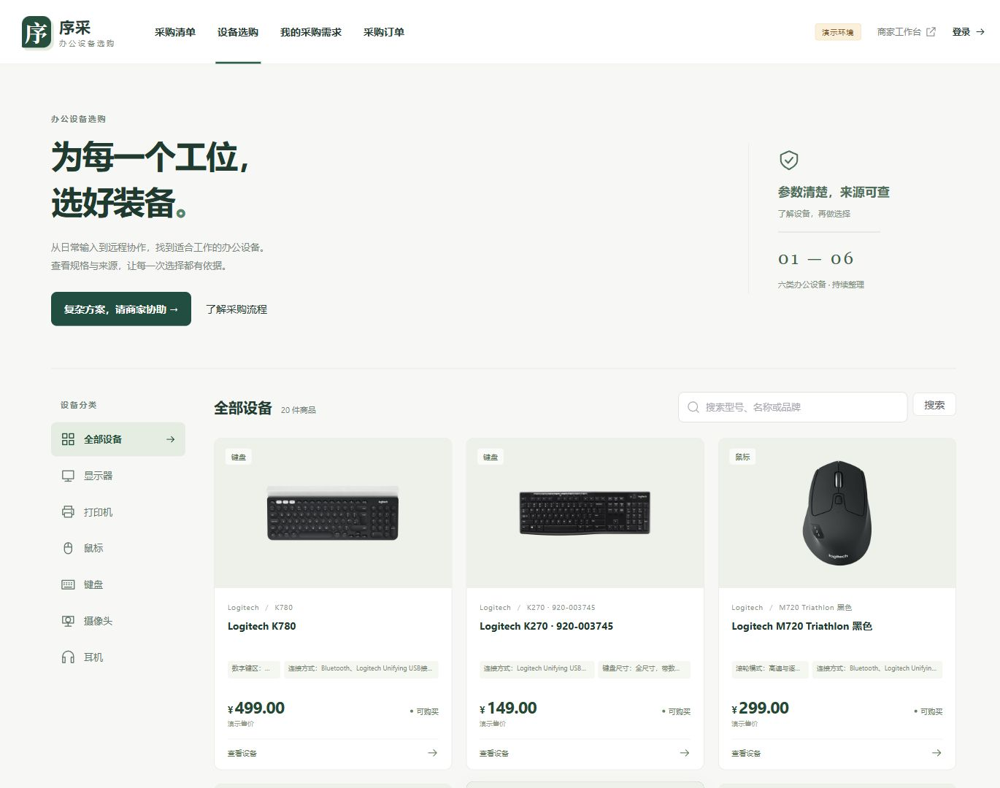
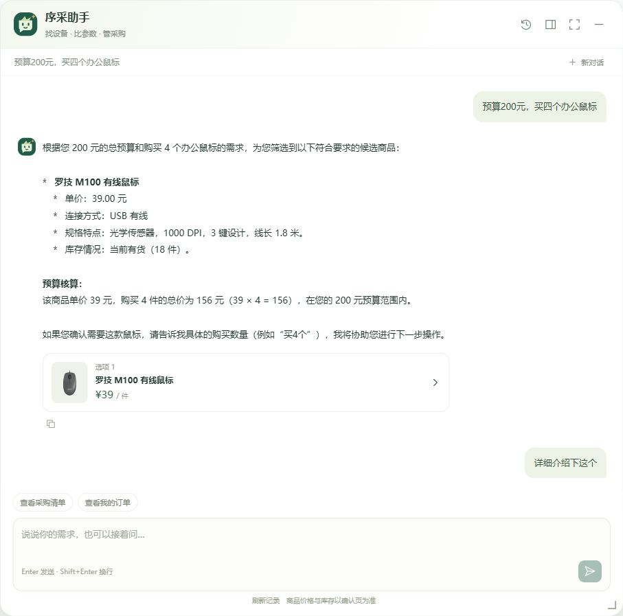
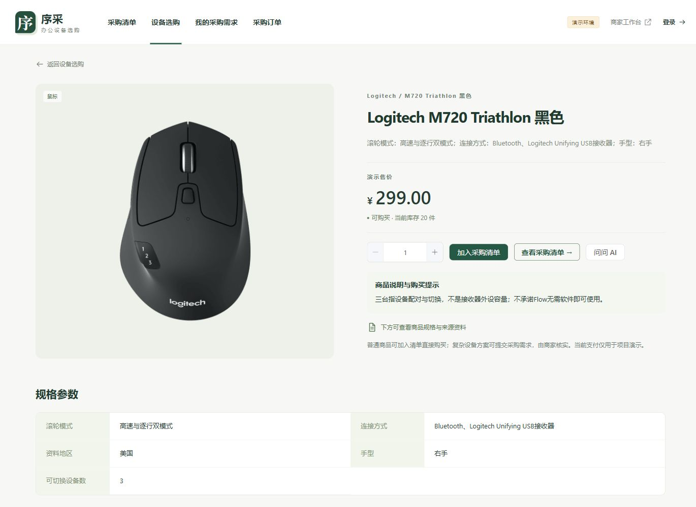
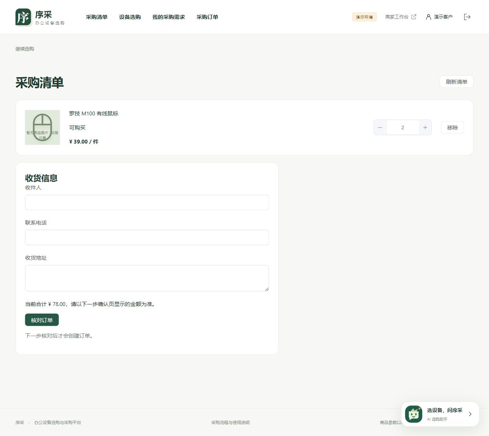
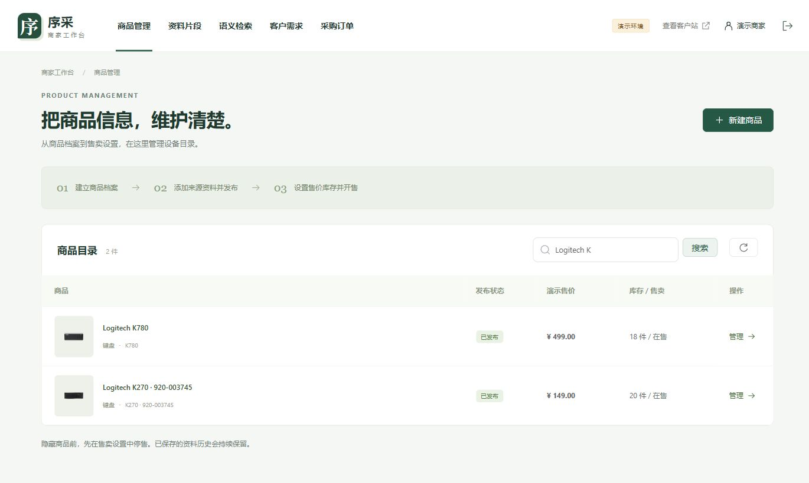

# 序采 · AI 办公设备选购与采购平台

序采是面向办公设备采购的全栈项目，基于 Java、Spring Cloud、Spring AI 和 Vue 3 构建，包含客户站与商家工作台。

客户可以直接浏览商品、管理采购清单，也可以通过 AI 助手按用途、预算和数量选购设备、查询商品资料。涉及多设备搭配的采购需求，由商家核实并提供方案，后续通过统一的确认与订单流程完成采购。

项目重点围绕三个问题展开：

- **如何让对话接上业务**：结合选购条件、商品卡片和当前清单进行意图路由，通过受控工具读取商品或发起清单调整。
- **如何让商品回答有依据**：融合关键词与向量检索，按商品和资料版本筛选证据，保留出处与适用地区。
- **如何避免模型直接改错数据**：清单操作先形成待确认提议，用户确认后由服务端重新校验价格、数量和清单版本，再执行写入。

[页面展示](#页面展示) · [主要功能](#主要功能) · [关键设计](#关键设计) · [安装与运行](docs/安装与运行.md) · [功能演示](docs/功能演示.md)

## 页面展示

以下为运行界面实拍，点击图片可查看原图。部分页面使用默认商品示意图。

**设备选购**

[](docs/images/catalog.jpg)

**AI 助手 · 真实会话回放**

[](docs/images/assistant.jpg)

<details>
<summary>查看商品详情、采购清单与商家工作台</summary>

**商品详情**

[](docs/images/product.jpg)

**采购清单**

[](docs/images/cart.jpg)

**商家工作台**

[](docs/images/merchant.jpg)

</details>

## 主要功能

| 功能 | 客户端 | 商家端 |
| --- | --- | --- |
| 商品与资料 | 按分类浏览设备，查看规格、来源与适用地区 | 维护商品、图片和资料版本，设置售价与库存 |
| AI 助手 | 按条件选品、咨询资料、调整采购清单，管理会话历史与停止回复 | — |
| 采购方案 | 提交采购需求，查看商家方案及引用依据 | 选品、引用原文、逐项核实条件并发布方案 |
| 订单与售后 | 核对清单与订单，查看履约进度，提交售后咨询 | 处理订单、登记物流、跟进售后 |

项目提供三条采购路径：

- **普通采购**：浏览商品 → 加入清单 → 核对数量、金额与收货信息 → 确认下单。
- **AI 选购**：说明用途与预算 → 查看推荐设备、追问资料 → 确认清单调整 → 回到业务页面核对下单。
- **商家方案**：提交采购需求 → 商家选品并核实资料 → 发布方案 → 客户确认订单。

支付与物流采用演示流程，不涉及真实收款或配送。

## 技术栈

| 层次 | 技术 |
| --- | --- |
| 后端 | Java 17、Spring Boot 3、Spring Cloud、MyBatis Plus |
| AI 应用 | Spring AI、Spring AI Alibaba、百炼模型、SSE |
| 数据与中间件 | MySQL 8、Redis Stack、Nacos、阿里云 OSS |
| 前端 | Vue 3、Vite、Element Plus |

## 关键设计

### 对话路由与受控工具调用

助手根据用户意图在通用交流、选购、资料咨询、采购订单四类角色间路由，结合最近商品卡片、选购条件和当前清单衔接对话。后端通过工具白名单、执行轮次与取消状态控制调用，生成文本经 SSE 返回；会话与操作结果持久化，支持历史查看和继续交流。

### 商品资料检索与版本引用

商品资料保留原文、出处、地区及版本。检索将关键词匹配与向量候选通过 RRF 融合，按商品及当前资料版本筛选证据；未配置向量检索时使用关键词查询。商家方案引用具体资料片段，并保留核实依据，便于客户追溯规格与适用条件。

### 清单操作的确认与校验

模型负责理解意图，服务端负责校验与执行。清单调整先形成待确认操作，绑定当前用户、商品、数量、价格及清单版本；用户可以补充数量、修改或取消。确认时重新检查价格、版本和有效期，再调用交易接口，防止过时提议或重复确认覆盖当前清单。

采购预算默认约束本次新增商品；用户明确指定整单预算时，按整张清单计算。最终下单由用户在业务页面核对确认。

### 身份隔离与交易一致性

网关通过 JWT 与固定角色路由区分客户和商家，业务服务继续校验需求、订单和会话的数据归属。普通采购与助手共用交易规则，通过订单快照、幂等确认、库存扣减与取消归还处理订单状态变化。

## 模块结构

前端统一通过网关访问六个后端应用。用户与认证模块提供身份能力，目录与交易模块承载采购业务，AI 模块调用受控业务接口完成对话编排。

| 模块 | 职责 |
| --- | --- |
| `web` | 客户站、商家工作台、AI 助手浮窗 |
| `xucai-gateway` | 身份校验、路由与角色授权 |
| `xucai-auth` / `xucai-user` | 登录、会话续期与用户资料 |
| `xucai-catalog` | 商品、图片、原文资料及版本，聚合售卖信息 |
| `xucai-trade` | 售价库存、需求、方案、清单与订单 |
| `xucai-ai` | 对话编排、工具调用、资料检索与模型用量记录 |
| `xucai-api` / `xucai-common` | 模块间接口与公共组件 |

MySQL 保存业务状态，Nacos 提供服务发现，Redis Stack 支持向量检索，OSS 存储商品图片。

## 本地运行

开发环境：**JDK 17、Maven 3.8.1、Node.js 22.12+**；中间件使用 MySQL、Redis 和 Nacos。首次运行需按[安装与运行](docs/安装与运行.md)初始化数据库、生成本地配置并导入演示商品。

**后端**：在 IntelliJ IDEA 中打开根目录 `pom.xml`，加载 Maven 项目。完成本地配置后，选择仓库自带的“序采-全部后端”运行配置，或分别 Run / Debug 六个 Spring Boot 应用。

**前端**：在项目根目录的终端执行：

```bash
cd web
npm ci
npm run dev
```

访问 `http://127.0.0.1:5173`，使用安装文档中的客户或商家演示账号登录。依赖已安装且锁文件未变时，日常启动只需 `npm run dev`。

普通采购与商家方案无需模型 Key。AI 对话需配置百炼模型；向量检索需配置 Redis Stack 索引；商品实物图需配置 OSS 并上传素材。新安装默认关闭模型调用，未配置图片时显示设备示意图。

完整操作步骤见[功能演示](docs/功能演示.md)。
